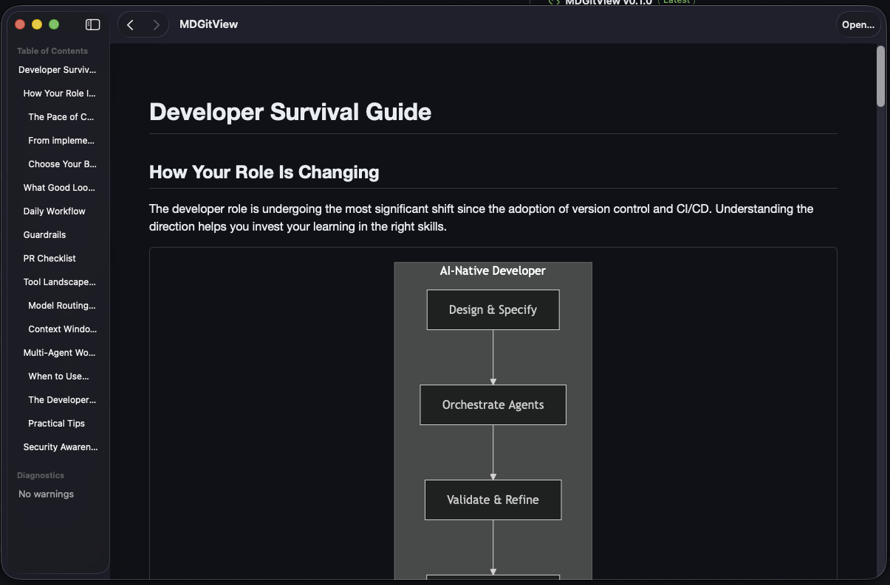

# MDGitView

macOS Markdown viewer with a Rust rendering core and SwiftUI + Quick Look integration.
Browse Markdown files in your projects with GitHub-style tables, Mermaid diagrams, a table of contents, and links between documents.

**Created by Toni Hintikka with AI coding assistants.**



## Installation

1. Download the latest `.app` from [GitHub Releases](https://github.com/tonihintikka/MDGitView/releases)
2. Unzip and drag `MDGitView.app` to `/Applications`
3. Open the app once. macOS needs this to activate its Quick Look extensions.
4. Done! You can now preview `.md` files with Quick Look in Finder

> **Note:** On first launch, macOS may show a security dialog. Click "Open" to allow the app to run. If the dialog says the app "can't be opened", go to System Settings > Privacy & Security and click "Open Anyway".

## Features

- GitHub-style rendering: tables, task lists, autolinks, and fenced code blocks
- Mermaid diagrams: rendered in the viewer with zoom and pan controls. Click Tools on any diagram.
- MathJax: mathematical notation support
- Table of contents: generated from document headings
- Dark mode: adapts to your system appearance
- Linked documents: open Markdown files in the same project
- Local images: relative image paths resolve within the project
- HTML sanitization: unsafe content is filtered out

## How it works

The Rust `md-engine` crate parses Markdown, builds the table of contents, applies the local-resource policy, and sanitizes HTML. The `md-ffi` crate exposes that renderer to the Swift app through a C ABI. The macOS app presents the result in WebKit and serves the generated document, bundled assets, and permitted local files through a private `mdgitview:` URL scheme. No remote scripts or stylesheets are needed.

Quick Look preview and thumbnail extensions are separate targets. The preview extension uses the shared Rust renderer and its own Quick Look HTML reply; it does not use the app's `WKURLSchemeHandler`.

## Quick Look

MDGitView includes a Finder Quick Look extension. Select a `.md` file in Finder and press **Space** to see styled Markdown.

The preview includes an **"Open in MDGitView"** button (top-right corner) to quickly open the file in the full app. Quick Look shows sanitized Markdown and blocks remote images. Local raster images are embedded only when the extension can read them; the macOS sandbox can deny access to sibling files. Mermaid and math source remain visible with a note that they render in the full app when no cached PDF is available.

After a document is opened in MDGitView, the app renders a PDF using its bundled Mermaid and MathJax assets and stores it in the shared App Group cache. Quick Look uses this PDF when the Markdown file matches and the entry is less than five minutes old. The cache holds up to 250 MiB. On a cold cache, Quick Look uses its HTML preview, so Mermaid and math remain source text and sibling images may be unavailable. Opening or refreshing the document in MDGitView refreshes the cached PDF.

### Quick Look troubleshooting

If Quick Look doesn't show the rendered preview, check whether another Markdown preview extension is selected. On this development machine, Obsidian's extension was selected and failed, causing a plain-text fallback. Disabling that Quick Look extension and restarting Finder allowed MDGitView's extension to render. The Obsidian app itself can remain installed and usable.

Other checks:

1. Make sure you've opened MDGitView.app at least once
2. Check System Settings > Privacy & Security > Extensions > Quick Look. MDGitView should be enabled.
3. Reset the Quick Look cache:
   ```
   qlmanage -r
   ```
4. Test from terminal:
   ```
   qlmanage -p /path/to/file.md
   ```

## Usage

### Opening files

- **Drag & drop** a `.md` file onto the app icon
- **File > Open** (or **Cmd+O**) to browse for a file
- **Double-click** a `.md` file in Finder (if MDGitView is set as default)

### Keyboard shortcuts

| Shortcut | Action |
|----------|--------|
| Cmd+O | Open file |
| Cmd+R | Refresh document |
| Cmd+E | Open in external editor |
| Shift+Cmd+R | Reveal in Finder |
| Cmd+[ | Navigate back |
| Cmd+] | Navigate forward |

### Setting as default Markdown viewer

Right-click any `.md` file in Finder > Get Info > Open With > select MDGitView > click "Change All".

## Changelog

See [CHANGELOG.md](CHANGELOG.md) for release history.

## Building from source

See [DEVELOPMENT.md](DEVELOPMENT.md) for build instructions, project layout, and contributing guidelines.

When updating dependencies, review Rust crates, vendored JavaScript (Mermaid and MathJax), and the Xcode SDK. See [Dependency updates](DEVELOPMENT.md#dependency-updates).

For architecture, security boundaries, release steps, and project-specific AI agent context, see [the documentation index](docs/README.md) and [now.md](now.md).

## Open source credits (Mermaid)

Mermaid diagram rendering in MDGitView is powered by the vendored Mermaid runtime in `md-viewer-macos/Resources/Assets/mermaid.min.js`.

- [Mermaid](https://github.com/mermaid-js/mermaid) (v11.15.0) - MIT
- [DOMPurify](https://github.com/cure53/DOMPurify) (bundled via Mermaid) - Apache-2.0 / MPL-2.0
- [js-yaml](https://github.com/nodeca/js-yaml) (bundled via Mermaid) - MIT
- [lodash-es](https://github.com/lodash/lodash) (bundled via Mermaid) - MIT
- [cytoscape.js](https://github.com/cytoscape/cytoscape.js) (bundled via Mermaid) - MIT

Version and bundled license details were verified from `md-viewer-macos/Resources/Assets/mermaid.min.js` and `md-viewer-macos/Resources/ThirdParty/versions.json`.

## Open source credits (MathJax)

Mathematical notation is rendered with the vendored MathJax runtime in `md-viewer-macos/Resources/Assets/mathjax.js`.

- [MathJax](https://github.com/mathjax/MathJax) (v4.1.2) - Apache-2.0

## License

MIT
